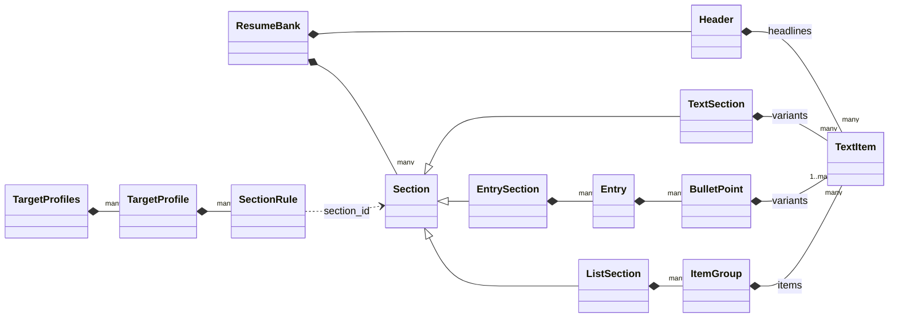

# Jobot

**Tailor your CV to every job posting, without inventing anything.**

Jobot is a local desktop app (work in progress) that keeps one bank of your real experience and builds a tailored CV for each job posting. An AI model chooses and rewords content from your bank according to rules you set per target role. Code then checks the result, so nothing on the CV is made up.

> **Status:** early development. The data model, validation and storage are done and tested. The AI layer, CV rendering and the UI are next. See the [roadmap](#roadmap).

---

## How it will work

1. **Fill your bank once.** Everything you could put on a CV: experience, projects, military service, skills, and so on, including several versions of the same bullet point.
2. **Define target profiles,** for example "NOC student" or "SOC analyst". A profile decides which sections appear, in what order, how many items, and how much freedom the AI gets in each section.
3. **Give it a job posting** (pasted text or a link).
4. **The AI chooses content from your bank** and returns structured JSON, never free text.
5. **Code validates the answer** against your bank: every item must exist, and rewrites can't add facts.
6. **The CV is rendered** within the profile's page limit.

## Key design ideas

- **One bank, many profiles.** Your experience is stored once. Profiles only reference it by ID, so nothing gets duplicated or drifts out of sync.
- **Three content modes per section:**
  - `SELECT`: pick existing items as they are
  - `REPHRASE`: reword existing items, with no new facts
  - `GENERATE`: write new items, but only from facts you provided in descriptions
- **Bullet variants.** Each bullet point can have several wordings (technical vs. managerial, long vs. short). The AI picks the best one for the job, and the page-fitting step can swap in a shorter variant before dropping a point.
- **Traceability.** Every text item records its origin (`user`, `rephrased` or `generated`). Rephrased items point back to the original they came from.
- **Validation at every level.** Invalid data (impossible dates, contradictory rules, empty text...) is rejected by the models themselves, and every rule has a test that proves it.
- **Swappable AI provider.** One interface in front of the model, with a cloud API (such as Claude) or a local LLM through Ollama behind it.
- **Local-first.** Your data stays on your machine as JSON files, saved atomically so a crash can't corrupt them.

## Data model (overview)



The full diagram with every field, and the reasoning behind the design, are in [docs/DESIGN.md](docs/DESIGN.md).

## Roadmap

- [x] Resume bank data model (sections, entries, bullet variants, skills)
- [x] Target profiles (section rules, content modes, page limit)
- [x] Validation rules with tests
- [x] JSON storage with atomic saves
- [ ] Job posting input (pasted text or link)
- [ ] AI answer format and mapping back to the bank
- [ ] AI providers: Claude API and a local LLM (Ollama)
- [ ] No-fabrication validator
- [ ] CV rendering with page-limit fitting
- [ ] Desktop UI (PySide6)
- [ ] Later: job discovery from company career pages, auto-apply

## How it's built

**Zero AI in the backend code.** I design it and write every line myself. The design started as a hand-drawn class diagram, which is in [docs/DESIGN.md](docs/DESIGN.md) along with how it evolved.

The desktop UI will be AI-generated on top of the backend, since UI design isn't the focus of this project.

## Running the tests

Requires Python 3.12+.

```bash
python -m venv .venv
.venv\Scripts\activate          # Windows
pip install pydantic pytest
python -m pytest
```

## Project structure

```
cv/
  resume.py        # resume bank models
  profiles.py      # target profile models
  storage.py       # JSON save/load (atomic)
  id_generator.py  # short random IDs
tests/
  conftest.py      # shared sample data
  test_*.py        # round-trip, storage and validation tests
docs/
  DESIGN.md        # design decisions and full class diagram
```

## License

MIT
