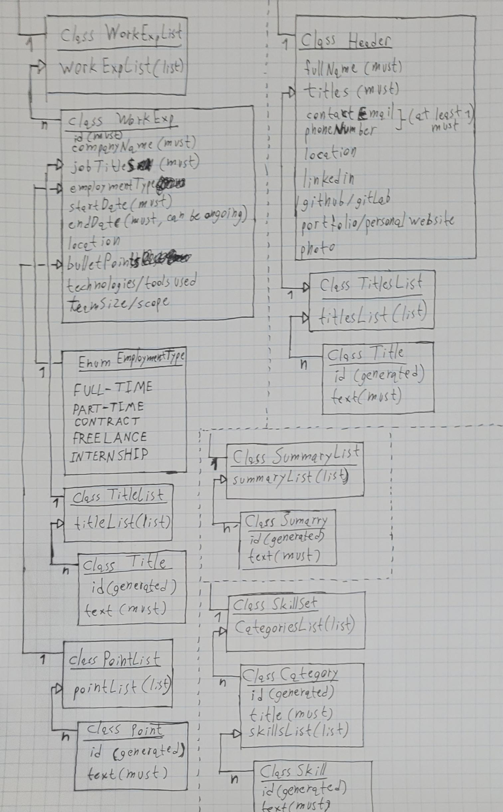
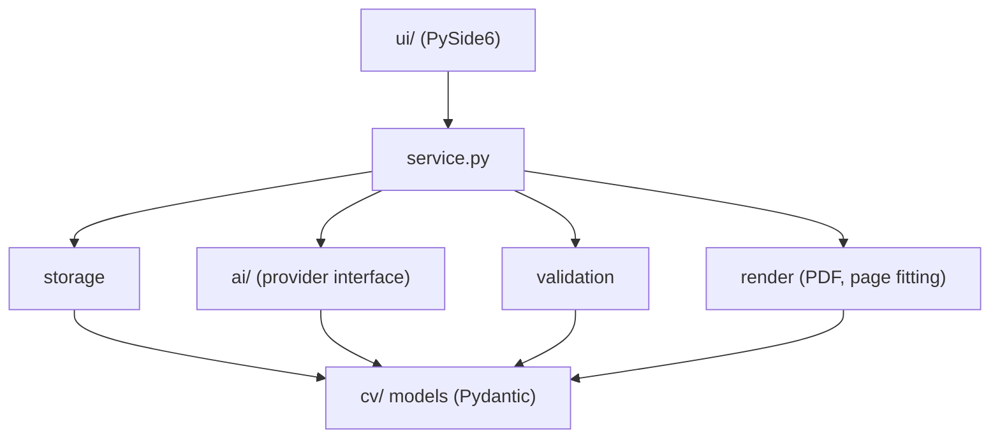
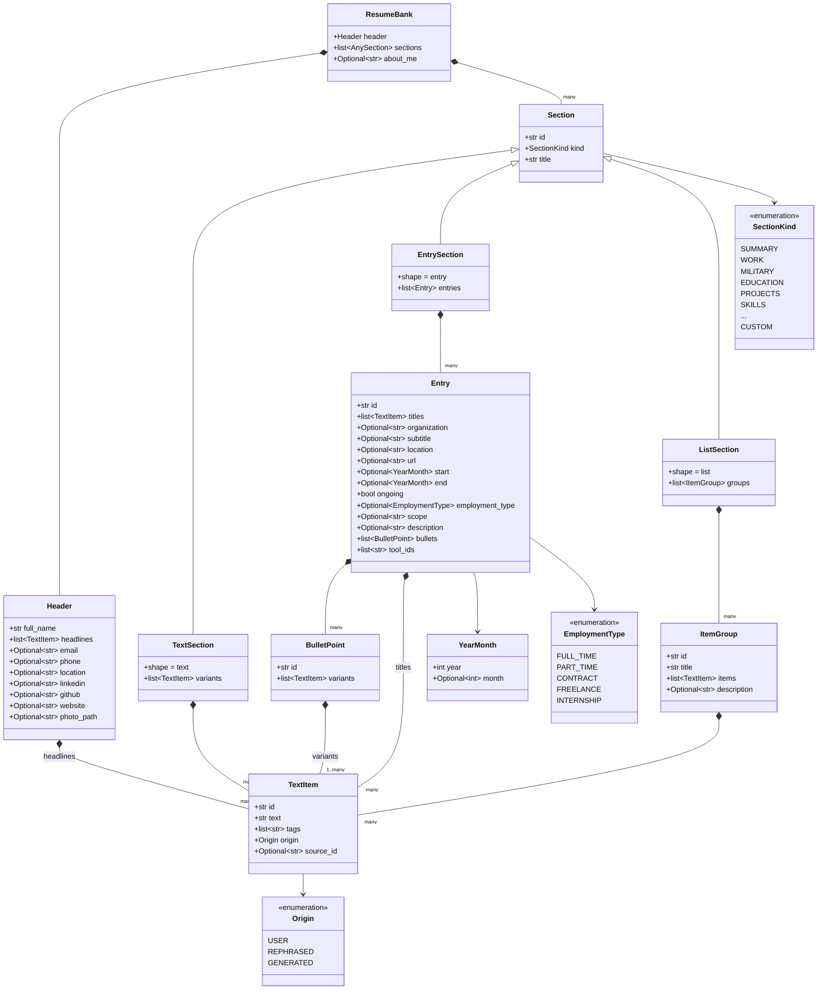
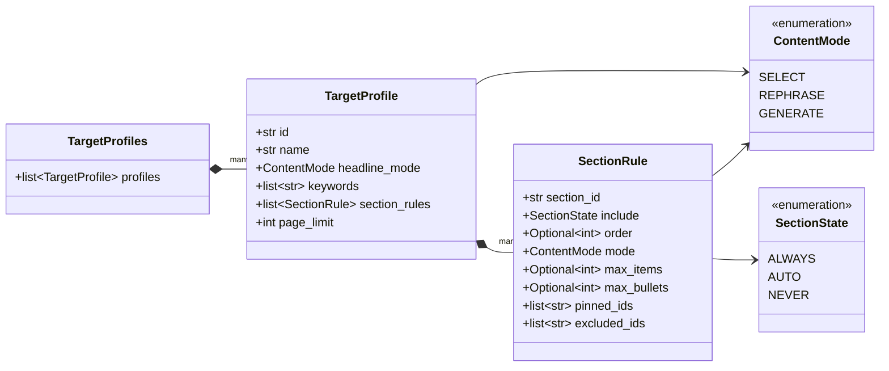

# Design notes

This document explains how Jobot's design came together: where it started, what changed along the way, and why.

## The idea

Tools that find jobs and tailor CVs exist, but most of them are paid, and none of them focus on the Israeli market. I wanted my own: a local app where my data stays on my machine, that works with either a cloud AI API or a local model, and that never invents experience I don't have.

## Starting point: a hand-drawn class diagram

Before writing any code, I sketched the data model on paper: the header, work experience, titles, bullet points, summaries and skills, with what each one contains and which fields are required.

*A rough first sketch of the system. The design changed a lot after this initial draft. See the sections below and the full class diagram for the current model.*

## From sketch to model

Turning the sketch into code changed several things:

- **No wrapper classes.** The sketch had classes like `WorkExpList` that only held a list. In Python a field can simply be a list (`bullets: list[BulletPoint]`), so they went away.
- **One class for every pickable line.** Titles, summaries, bullets and skills were all "an ID plus some text," so they became one class, `TextItem`.
- **Three section shapes instead of a class per section.** A CV can have 15+ kinds of sections (work, military, education, projects, certifications...), but they come in only three shapes:
  - **text:** alternatives to choose one from, like a summary
  - **entry:** entries with dates and bullet points, like jobs or projects
  - **list:** grouped items, like skills

  Each section has a `kind` (what it's about) and a `shape` (how it's built). `CUSTOM` sections can use any shape.
- **Loading the right subclass back.** A list of sections holds three different subclasses. Without extra information, saving to JSON silently dropped the subclass fields. A round-trip test caught this. The fix is a Pydantic **discriminated union**: each subclass has a fixed `shape` value, and the loader uses it to build the right class.

## IDs

- **Random short IDs, not content hashes.** A hash of the text would change whenever the text is edited, which would break every reference to it. Identity has to survive edits.
- **Lists, plus an index built when needed.** Order matters on a CV, so items are stored in lists. When fast lookup by ID is needed, for example to check an AI answer, a `{id: item}` dict is built on the spot and thrown away afterwards. There's one source of truth, and it can't get out of sync.

## Giving the AI room without letting it invent

- **Content modes.** Each section in a profile is set to `SELECT`, `REPHRASE` or `GENERATE`, which controls how much freedom the AI gets there.
- **Descriptions.** Entries and skill groups have a free-text `description` field with raw facts. `GENERATE` mode writes only from those facts, so it's grounded in something real.
- **Bullet variants.** A `BulletPoint` separates *what* you say (the point) from *how* you say it (its variants). Pins and exclusions refer to the point, the AI chooses one variant per point, and a CV never shows two variants of the same point.
- **Traceability.** `TextItem.origin` records whether a line came from me, was rephrased, or was generated. A rephrased item must have a `source_id` pointing at its original, so a validator can compare the rewrite against it.

## Target profiles

A profile is a recipe for one kind of job:
- **One rule per section:**
  - include it `ALWAYS`, `AUTO` (the AI decides per job) or `NEVER`
  - its order, its content mode, and limits on items and bullets
  - pinned and excluded items
- **`headline_mode`:** the header isn't a section, so its title lines get their own mode.
- **`page_limit`:** CVs aren't always one page.

## Validation

Every rule lives in the model and has a test that feeds it bad data:
- empty text
- a rephrased item without a source
- a bullet point without variants
- an end date before the start date
- both `end` and `ongoing` set
- an ID both pinned and excluded
- two rules for the same section
- a page limit of 0

The tests caught real bugs along the way: a crash when comparing missing months, validators raising the wrong exception type, and the section data loss described above.

## Storage

- JSON files with one file per top-level model. The file name is looked up by class.
- The data folder is passed in by the caller, never hard-coded.
- **Atomic saves:** the data is written to a temporary file first, then swapped into place, so a crash mid-save can't corrupt the only copy of the bank.

## Architecture

Imports only point down, so there are no import cycles, and the UI or the AI provider can be replaced without touching the layers below.

## Full class diagram (implemented)

### Resume bank

### Target profiles

## Next

- **The job posting model,** then the **AI answer format:** score, reasons, and the chosen item IDs per section in ranked order, plus rewrites and generated items.
- **Mapping:** turn the AI answer back into concrete CV content, tested with hand-written answers so no API calls are needed.
- **The AI provider interface,** with Claude and Ollama behind it.
- **The no-fabrication validator,** then rendering and page fitting.
- **Open decisions:**
  - which section kinds allow which shapes
  - sections a profile doesn't mention default to `AUTO`
  - generated text must be approved by me before it can enter the bank
